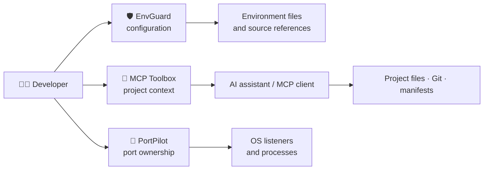

# Infinite Toolbox

<p align="center">
  
</p>

<p align="center">
  <strong>Small tools. Real problems. No accounts, no telemetry.</strong>
  <br />
  An open-source collection of focused command-line utilities for everyday development.
</p>

<p align="center">
  <a href="https://github.com/erfmollaey/infinite-toolbox/actions/workflows/envguard.yml"></a>
  <a href="https://github.com/erfmollaey/infinite-toolbox/actions/workflows/mcp-tools.yml"></a>
  <a href="https://github.com/erfmollaey/infinite-toolbox/actions/workflows/portpilot.yml"></a>
  
</p>

<p align="center">
  <a href="#the-toolbox">Tools</a> ·
  <a href="#design-principles">Principles</a> ·
  <a href="#quick-start">Quick start</a> ·
  <a href="#technology">Technology</a> ·
  <a href="#contributing">Contributing</a> ·
  <a href="#license">License</a>
</p>

---

## Overview

**Infinite Toolbox** is a single repository for small, dependable developer tools, each solving one recurring problem well. Every tool runs locally, ships with tests, and can be adopted — or released — on its own.

No platform account. No API key. No background service. Just a command you can run when something in your development environment is off.

The collection currently contains three tools:

| Tool | What it fixes | Runtime |
| --- | --- | --- |
| 🛡️ [**EnvGuard**](envguard/) | Environment configuration mistakes: missing variables, stale templates, tracked `.env` files, exposed `NEXT_PUBLIC_*` values | Python 3.12+ |
| 🧰 [**Infinity MCP Toolbox**](mcp-tools/) | AI assistants that cannot see your project's structure, Git state, environment templates, or dependencies | Node.js 18+ |
| 🚢 [**PortPilot**](portpilot/) | `EADDRINUSE`: which process owns a port, and how to free it without killing the wrong thing | Node.js 18+ |

## Why Infinite Toolbox

Most projects accumulate the same little helpers: a script that checks `.env`, a one-off audit for a forgotten port, a snippet that gives an AI assistant repository context. They live in private gists, get rewritten per project, and are never tested.

Infinite Toolbox gives those helpers a home with consistent standards:

- **One problem per tool.** Narrow scope, readable output, no configuration ceremony.
- **Local-first by default.** Core functionality does not require a network, account, or paid service. No telemetry, no uploads.
- **Safe by construction.** Tools that touch secrets, processes, or repositories are designed to fail closed.
- **Tested, not promised.** Each tool has its own suite and CI workflow, and its README states what is verified and what is not.
- **Independent lifecycle.** Separate directories, manifests, versions, and licenses — adopt one tool without adopting the rest.

## The Toolbox

### 🛡️ [EnvGuard](envguard/)

**Environment configuration, verified before it breaks a deploy.**

EnvGuard inspects the environment variables your code actually references and compares them with your `.env` and template files. It also flags real `.env` files that Git is tracking and variables in the `NEXT_PUBLIC_*` namespace that would ship to the browser bundle.

```console
$ envguard check
...
Summary: 2 error(s), 1 warning(s), 1 info
```

- Five commands: `check`, `init`, `sync`, `scan`, `doctor`.
- Never prints environment **values** — only names, counts, paths, and line numbers.
- Supports Python, JavaScript/TypeScript, and Next.js reference patterns.
- Machine-readable `check --json` output and CI-friendly exit codes with `--strict`.
- `sync` is a dry run unless `--apply` is passed; write operations never follow symlinks.

<sub>**Requirements:** Python 3.12+ · Typer + Rich · Git optional · [Documentation](envguard/README.md) · [Source](envguard/)</sub>

### 🧰 [Infinity MCP Toolbox](mcp-tools/)

**Four developer tools. One read-only MCP server for your AI assistant.**

A [Model Context Protocol](https://modelcontextprotocol.io/) server that exposes structured project context to MCP-compatible clients: project structure, Git state, environment templates, and dependency manifests.

| Tool | Purpose |
| --- | --- |
| 🩺 `infinity_project_doctor` | Project layout and missing recommended files |
| 🌿 `infinity_git_context` | Branch, working-tree status, diff stats, recent commits |
| 🔐 `infinity_environment_inspector` | Environment templates without exposing values |
| 📦 `infinity_dependency_inspector` | `package.json` and `requirements.txt` parsing without installing anything |

- Strictly read-only operations inside workspace boundaries.
- Secret redaction for environment values and diff output.
- Git subprocesses use fixed arguments, `shell: false`, and bounded output.
- Published on npm and installable through npx; also runnable from source.

<sub>**Requirements:** Node.js 18+ · TypeScript · MCP STDIO · [Documentation](mcp-tools/README.md) · [Source](mcp-tools/)</sub>

### 🚢 [PortPilot](portpilot/)

**Find out what owns a port — and free it only when it is safe.**

PortPilot replaces `lsof` archaeology and blind `kill -9` with an inspection-and-termination workflow for local TCP ports. It shows the PID, process name, address, and available details, then optionally terminates the listener behind explicit confirmations.

```console
$ portpilot 3000
! Port 3000 is occupied by 1 process:
  node (PID 1234)
    TCP 127.0.0.1:3000

What would you like to do?
  1) Inspect process details
  2) Free the port
  3) Cancel
>
```

- `list`, `find <port>`, `inspect <port>`, `free <port>`, and `portpilot <port>`.
- Native discovery on macOS (`lsof`/`netstat`), Linux (`lsof`/`/proc`), and Windows (`netstat`/`tasklist`/PowerShell).
- Every termination revalidates the captured start-time marker, so a recycled PID is refused.
- Graceful termination first; force termination always needs a second confirmation. No privilege escalation.
- Inspection keeps working when Windows CIM is slow or unavailable; termination refuses without a verifiable start-time marker.

<sub>**Requirements:** Node.js 18+ · No runtime dependencies · [Documentation](portpilot/README.md) · [Source](portpilot/)</sub>

## How the tools fit together



Each tool is independent. They share a philosophy — read-only where possible, explicit about limits, and local-first — not a runtime or a daemon.

## Design principles

| Principle | What it means in practice |
| --- | --- |
| 🎯 Genuine utility | A tool exists because developers already do the task by hand. |
| 🪶 Small footprint | Minimal dependencies, short output, no build system of its own. |
| 🔒 Local and private | No telemetry or uploads; secrets are handled by construction. |
| 🧪 Verification over claims | Behavior changes come with tests; unsupported platforms are labeled. |
| 📦 Independent releases | Every directory has its own manifest, version, and license. |

## Quick start

Clone the repository once, then work inside the tool you need:

```bash
git clone https://github.com/erfmollaey/infinite-toolbox.git
cd infinite-toolbox
```

**EnvGuard**

```bash
cd envguard
python3 -m venv .venv
source .venv/bin/activate        # Windows: .venv\Scripts\activate
pip install -e ".[dev]"
envguard check
```

**Infinity MCP Toolbox**

```bash
cd mcp-tools
npm ci
npm run build
npm start                        # MCP server over STDIO
```

**PortPilot**

```bash
cd portpilot
npm ci
npm run build
node cli.js --help
```

> **Distribution status:** [EnvGuard](https://pypi.org/project/infinity-envguard/) is published on PyPI with a [GitHub Release](https://github.com/erfmollaey/infinite-toolbox/releases). [Infinity MCP Toolbox](https://www.npmjs.com/package/infinity-mcp-toolbox) is published on npm. [PortPilot](portpilot/) is not yet published — install it from this repository.

## Repository structure

```text
infinite-toolbox/
├── README.md                 # this file — collection overview
├── public/
│   └── Infinite Toolbox logo.webp
├── .github/
│   └── workflows/            # per-tool CI and release workflows
├── envguard/                 # 🛡️ Python CLI — environment configuration
│   ├── README.md
│   ├── pyproject.toml
│   ├── src/envguard/
│   └── tests/
├── mcp-tools/                # 🧰 TypeScript MCP server — project inspection
│   ├── README.md
│   ├── package.json
│   ├── src/
│   └── tests/
└── portpilot/                # 🚢 TypeScript CLI — TCP port processes
    ├── README.md
    ├── BUILD.md
    ├── package.json
    ├── src/
    └── tests/
```

Each directory is a self-contained project. There is no shared root package manifest and no workspace lockfile coupling the tools together.

## Technology

| Tool | Language | Key libraries | Tests | Packaging |
| --- | --- | --- | --- | --- |
| EnvGuard | Python 3.12+ | Typer, Rich | pytest, ruff, mypy | PyPI + GitHub Release |
| MCP Toolbox | TypeScript | MCP SDK, Zod | Vitest, ESLint, Prettier | npm / npx |
| PortPilot | TypeScript (CommonJS) | Node built-ins only | Node test runner, ESLint, Prettier | npm / `bin` (unpublished) |

Continuous integration is defined per tool in `.github/workflows/`. PortPilot and MCP Toolbox test across Node.js versions; EnvGuard tests across Python 3.12–3.14.

## Contributing

Contributions, bug reports, and ideas are welcome.

1. **Open an issue** describing the problem, the affected tool, and a minimal reproduction where possible.
2. **Keep pull requests scoped** to one tool. Include tests for behavior changes.
3. **Never commit real secrets.** Fixtures must use obvious placeholder values, and no `.env` file containing real credentials should enter the repository.
4. **New tools:** discuss the problem and scope first. A tool belongs here when it solves one recurring developer problem, runs offline, and stays small.

Repository: [erfmollaey/infinite-toolbox](https://github.com/erfmollaey/infinite-toolbox) · Issues: [github.com/erfmollaey/infinite-toolbox/issues](https://github.com/erfmollaey/infinite-toolbox/issues)

## License

Each tool carries its own MIT license:

- EnvGuard — [`envguard/LICENSE`](envguard/LICENSE)
- Infinity MCP Toolbox — [`mcp-tools/LICENSE`](mcp-tools/LICENSE)
- PortPilot — [`portpilot/LICENSE`](portpilot/LICENSE)

The presence of a license file in one tool's directory does not imply license terms for another tool.

---

<p align="center">
  <strong>Built with ❤️ by Infinity™</strong>
  <br />
  <sub>Tools that make development smarter.</sub>
</p>

<p align="center">
  <a href="https://github.com/erfmollaey/infinite-toolbox">Repository</a> ·
  <a href="https://teaminfinity.ir">Infinity™</a>
</p>
