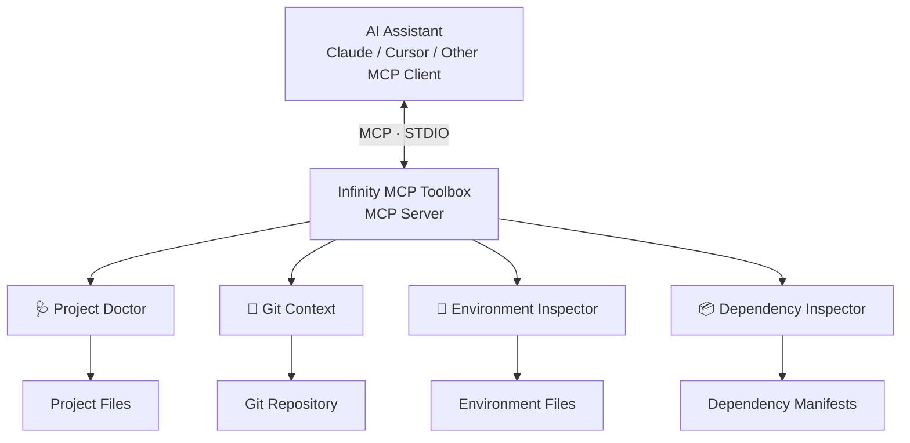

# Infinity MCP Toolbox

<p align="center">
  <strong>Four developer tools. One intelligent MCP server.</strong>
  <br />
  Give AI assistants structured insights into your development projects.
</p>

<p align="center">
  <a href="https://www.npmjs.com/package/infinity-mcp-toolbox"></a>
  <a href="https://www.npmjs.com/package/infinity-mcp-toolbox"></a>
  <a href="https://github.com/erfmollaey/infinite-toolbox/actions/workflows/mcp-tools.yml"></a>
  
  <a href="LICENSE"></a>
</p>

---

## Overview

**Infinity MCP Toolbox** is a lightweight, read-only [Model Context Protocol (MCP)](https://modelcontextprotocol.io/) server designed to help AI assistants understand software development projects.

It provides four specialized tools that allow MCP-compatible AI clients to inspect project structure, Git repository context, environment configuration, and dependency information.

Instead of manually gathering project details, your AI assistant can use these tools to obtain structured information directly from your development environment.

Built with TypeScript and Node.js, Infinity MCP Toolbox is designed to be simple to install, easy to integrate, and safe by default.

## Features

- **Four specialized MCP tools** for common development workflows.
- **Read-only operations** to inspect project information without modifying files.
- **Secret redaction** to reduce the risk of exposing sensitive environment values.
- **Git-aware context** for understanding repository state and metadata.
- **Dependency inspection** for understanding project packages and manifests.
- **Lightweight installation** through npm and npx.
- **Standard MCP communication** over STDIO.
- **No API key required** for local project inspection.

## Available Tools

| Tool | Description |
|---|---|
| 🩺 Project Doctor | Inspects project structure and identifies common project configuration issues. |
| 🌿 Git Context | Collects useful Git repository information and development context. |
| 🔐 Environment Inspector | Inspects environment configuration with heuristic secret redaction. |
| 📦 Dependency Inspector | Examines dependency manifests and provides structured dependency information. |

### How It Works



The AI client communicates with the MCP server, which exposes the four tools. Each tool inspects its relevant project information and returns structured results to the client.

---

## Requirements

- Node.js 18 or later
- npm
- An MCP-compatible AI client

No global installation is required.

## Installation

### Option 1: Run with npx (Recommended)

The easiest way to use Infinity MCP Toolbox is directly through npx:

```bash
npx -y infinity-mcp-toolbox@latest
```

This downloads and launches the package without requiring a global installation.

### Option 2: Install Globally

```bash
npm install -g infinity-mcp-toolbox
```

Then run:

```bash
infinity-mcp-toolbox
```

### Option 3: Install Locally

```bash
npm install infinity-mcp-toolbox
```

Run the executable through:

```bash
npx infinity-mcp-toolbox
```

---

## Configuration

Infinity MCP Toolbox uses the MCP STDIO transport, making it compatible with MCP clients that support local server processes.

### Claude Desktop

Open your Claude Desktop MCP configuration file and add the following server configuration:

```json
{
  "mcpServers": {
    "infinity-toolbox": {
      "command": "npx",
      "args": [
        "-y",
        "infinity-mcp-toolbox@latest"
      ]
    }
  }
}
```

Restart Claude Desktop after saving the configuration.

### Cursor

Add the following configuration to your Cursor MCP configuration:

```json
{
  "mcpServers": {
    "infinity-toolbox": {
      "command": "npx",
      "args": [
        "-y",
        "infinity-mcp-toolbox@latest"
      ]
    }
  }
}
```

### VS Code

For VS Code MCP-compatible configurations, add:

```json
{
  "servers": {
    "infinity-toolbox": {
      "type": "stdio",
      "command": "npx",
      "args": [
        "-y",
        "infinity-mcp-toolbox@latest"
      ]
    }
  }
}
```

> **Note:** MCP configuration locations and formats may vary between client versions. Refer to your client's documentation if necessary.

---

## Usage

Once the server is configured and your MCP client has connected, the four tools become available to your AI assistant.

You can use natural-language requests such as:

### Project Doctor

Examples:

- "Inspect this project and give me an overview of its structure."
- "Check the project configuration for common issues."
- "Help me understand the organization of this codebase."

### Git Context

Examples:

- "Analyze the current Git repository state."
- "Give me an overview of the current branch and working tree."
- "Help me understand the recent repository context."

### Environment Inspector

Examples:

- "Inspect the environment configuration of this project."
- "Check which environment variables are configured."
- "Identify potentially missing configuration values."

Sensitive values are subject to heuristic redaction. Do not assume that every secret can be detected.

### Dependency Inspector

Examples:

- "Analyze the dependencies used by this project."
- "Inspect the package manifests."
- "Give me an overview of the project's dependency configuration."

The AI assistant decides which available tool to invoke based on your request and the tool descriptions.

---

## Security

Security is an important design consideration.

Infinity MCP Toolbox is designed for read-only project inspection.

### Security Principles

- No arbitrary shell command execution.
- Read-only filesystem operations.
- Git subprocesses use fixed arguments.
- Git subprocesses run with `shell: false`.
- Controlled subprocess environment and bounded execution.
- Heuristic redaction for sensitive environment values.

### Security Limitations

No security mechanism is perfect. Keep the following limitations in mind:

- Filesystem operations may be subject to Time-of-Check to Time-of-Use (TOCTOU) race conditions.
- Secret redaction is heuristic and cannot guarantee detection of every secret.
- Dependency manifest parsing has known limitations.
- Some security tests are POSIX-specific.

**Recommendation:** Run the server only in project directories you trust. Review sensitive project files and permissions before granting an AI client access.

---

## Technology Stack

| Technology | Purpose |
|---|---|
| TypeScript | Application development |
| Node.js | Runtime |
| MCP SDK | Model Context Protocol implementation |
| Zod | Schema validation |
| Vitest | Automated testing |
| ESLint | Code quality |
| Prettier | Code formatting |

## Development

Want to contribute or explore the source code?

### Clone the Repository

```bash
git clone https://github.com/erfmollaey/infinite-toolbox.git

cd infinite-toolbox/mcp-tools
```

### Install Dependencies

```bash
npm ci
```

### Run Tests

```bash
npm test
```

### Type Checking

```bash
npm run typecheck
```

### Lint

```bash
npm run lint
```

### Build

```bash
npm run build
```

### Run Locally

```bash
node dist/index.js
```

The server communicates over STDIO. It is intended to be launched by an MCP client or a compatible protocol client.

---

## Project Structure

```text
mcp-tools/
├── src/
│   ├── core/
│   ├── tools/
│   │   ├── project-doctor/
│   │   ├── git-context/
│   │   ├── environment-inspector/
│   │   └── dependency-inspector/
│   ├── utils/
│   ├── server.ts
│   └── index.ts
├── tests/
├── dist/
├── package.json
├── tsconfig.json
├── vitest.config.ts
└── README.md
```

The `src/` directory contains the TypeScript implementation, while `dist/` contains the compiled JavaScript distributed with the npm package.

## Compatibility

| Requirement | Support |
|---|---|
| Node.js Runtime | 18+ |
| Package format | ESM |
| Transport | MCP STDIO |
| Installation | npm / npx |
| License | MIT |

The package runtime supports Node.js 18 and later. Development tooling has a separate Node.js requirement; the full CI quality pipeline currently runs on Node.js 20 and 24.

## Versioning

Infinity MCP Toolbox follows Semantic Versioning.

Current version: **0.1.0**

See the [GitHub Releases](https://github.com/erfmollaey/infinite-toolbox/releases) page for release notes and version history.

## Contributing

Contributions, suggestions, bug reports, and improvements are welcome.

If you find a bug or have an idea for a new tool:

1. Open an issue describing the problem or proposal.
2. Provide relevant reproduction steps when reporting a bug.
3. Submit a pull request with a clear description of your changes.

Please keep changes focused and include tests for new functionality.

## License

Infinity MCP Toolbox is released under the [MIT License](LICENSE).

Copyright © Infinity™.

## Part of Infinity™

Infinity MCP Toolbox is part of **[Infinite Toolbox](https://github.com/erfmollaey/infinite-toolbox)** — an open-source collection of practical developer tools built under the Infinity™ brand.

Explore more:

- [Infinite Toolbox Repository](https://github.com/erfmollaey/infinite-toolbox)
- [Infinity MCP Toolbox on npm](https://www.npmjs.com/package/infinity-mcp-toolbox)
- [Infinity™](https://teaminfinity.ir)

---

<p align="center">
  <strong>Built with ❤️ by Infinity™</strong>
  <br />
  <sub>Tools that make development smarter.</sub>
</p>