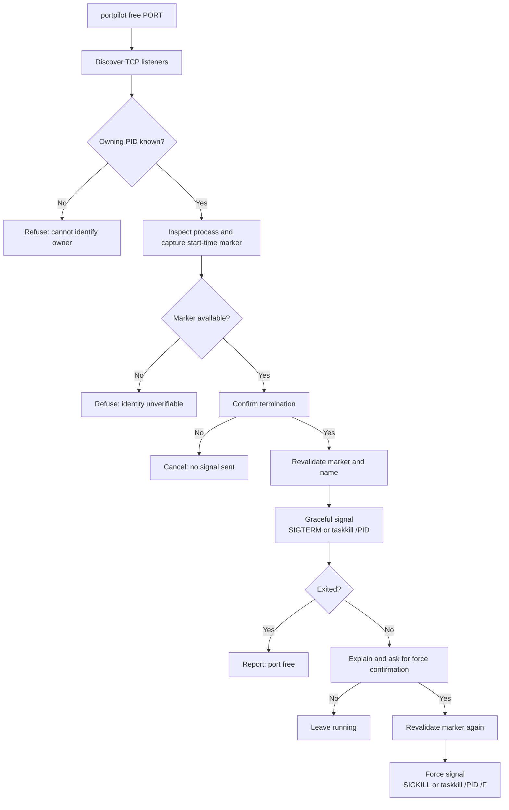

# PortPilot

<p align="center">
  <strong>Find out what owns a port. Free it only when it is safe.</strong>
  <br />
  A local-first CLI for inspecting TCP listeners and terminating the right process — with identity checks, not guesswork.
</p>

<p align="center">
  <a href="https://github.com/erfmollaey/infinite-toolbox/actions/workflows/portpilot.yml"></a>
  
  
  <a href="LICENSE"></a>
  
</p>

<p align="center">
  <a href="#overview">Overview</a> ·
  <a href="#commands">Commands</a> ·
  <a href="#safe-termination-workflow">Safety</a> ·
  <a href="#pid-reuse-protection">PID reuse</a> ·
  <a href="#windows-cim-timeout-behavior">Windows</a> ·
  <a href="#development">Development</a> ·
  <a href="#license">License</a>
</p>

---

## Overview

You know the error:

```text
Error: listen EADDRINUSE: address already in use :::3000
```

Something owns port 3000. `lsof` output is noisy, a stale PID may point at a different process, and `kill -9` is a guess with consequences.

**PortPilot** reads real operating-system listener data, shows you the owning PID and process, and — only after explicit confirmation — terminates it. Before every signal it revalidates the process identity it captured during inspection, so a recycled PID is refused instead of killed.

No mock data. No network calls. No elevated privileges.

## Features

| | Feature | What it gives you |
| --- | --- | --- |
| 🔎 | **Port inspection** | PID, process name, protocol, local address, and details when the OS exposes them |
| 🧭 | **Native discovery** | `lsof`, `netstat`, `/proc`, and PowerShell providers per platform |
| 🛑 | **Guarded termination** | Explicit confirmation, graceful signal first, separate force confirmation |
| 🪪 | **PID reuse protection** | Start-time identity markers revalidated before every signal |
| 🖥️ | **Cross-platform** | macOS, Linux, and Windows implementations |
| 🔐 | **No escalation** | Never invokes `sudo`, UAC, or a shell; permission errors are reported |
| 📦 | **Zero runtime dependencies** | Node.js built-ins only; no native modules |
| 🤖 | **Script-friendly reads** | Non-interactive inspection exits without prompting; meaningful exit codes |

## Supported platforms

| Platform | Primary discovery | Fallback | Process details |
| --- | --- | --- | --- |
| 🍎 macOS | `lsof -nP -iTCP -sTCP:LISTEN` | `netstat -an -p tcp` | `ps` (user, parent PID, state, start time, command line) |
| 🐧 Linux | `lsof -nP -iTCP -sTCP:LISTEN` | `/proc/net/tcp`, `/proc/net/tcp6`, `/proc/<pid>/fd` | `ps` |
| 🪟 Windows | `netstat -ano` + `tasklist` | PowerShell `Get-NetTCPConnection -State Listen` | `tasklist`, plus `Get-CimInstance Win32_Process` when PowerShell is available |

Only **TCP listeners** are discovered. UDP ports are not listed.

## Requirements

- **Node.js 18 or newer**
- macOS, Linux, or Windows
- No native dependencies and no runtime npm packages

## Installation

PortPilot is version `0.1.0` and is currently installed from this repository. It is **not published to npm yet**.

```bash
cd portpilot
npm ci
npm run build
node cli.js --help
```

To put the `portpilot` command on your `PATH` from this checkout:

```bash
npm link
portpilot list
```

Once published, the package exposes a `portpilot` binary through its `bin` entry.

## Quick start

```console
$ portpilot 3000
! Port 3000 is occupied by 1 process:
  node (PID 1234)
    TCP 127.0.0.1:3000

What would you like to do?
  1) Inspect process details
  2) Free the port
  3) Cancel
>
```

In a non-interactive shell, `portpilot 3000` prints the listeners and exits without prompting. Use `portpilot inspect 3000` for read-only details or `portpilot free 3000` to run the guarded termination flow.

If the port is free:

```console
$ portpilot 3000
✓ Port 3000 is available.
```

## Commands

| Command | Purpose | Example |
| --- | --- | --- |
| `portpilot <port>` | Inspect a port and offer actions in a TTY | `portpilot 3000` |
| `portpilot list` | List every TCP listening endpoint | `portpilot list` |
| `portpilot find <port>` | Show the processes listening on one port | `portpilot find 3000` |
| `portpilot inspect <port>` | Read-only detailed process inspection | `portpilot inspect 3000` |
| `portpilot free <port>` | Run the guarded termination workflow | `portpilot free 3000` |
| `portpilot --help` | Show usage and examples | `portpilot -h` |
| `portpilot --version` | Print the installed version | `portpilot -v` |

### `portpilot list`

Lists every TCP listening endpoint found through the platform provider.

```console
$ portpilot list

TCP listeners

PORT   PID    PROCESS   ADDRESS
─────  ─────  ────────  ───────────────
3000   1234   node      127.0.0.1:3000
5432   5678   postgres  [::1]:5432

2 listening endpoints found.
```

### `portpilot find <port>`

Shows the process or processes listening on one port, without the extra inspection lookup.

```console
$ portpilot find 3000
! Port 3000 is occupied by 1 process:
  node (PID 1234)
    TCP 127.0.0.1:3000
```

Multiple sockets owned by the same PID are merged into one entry. If several distinct processes share the port, each is listed.

### `portpilot inspect <port>`

Read-only detailed inspection. Includes user, parent PID, executable, state, start time, and command line when the operating system exposes them.

```console
$ portpilot inspect 3000
! Port 3000 is occupied by 1 process:

  Process 1234 (TCP 127.0.0.1:3000)
  PID           1234
  Process       node
  Port          3000
  Protocol      TCP
  Local address 127.0.0.1:3000
  User          dev
  Parent PID    1200
  Status        S
  Started       Fri Nov 20 19:36:26 2026
  Command       node server.js
```

`inspect` never signals a process.

### `portpilot free <port>`

Runs the guarded termination workflow described below. If the port is already free it exits successfully without touching anything.

```console
$ portpilot free 3000

Target: node (PID 1234)
  PID           1234
  ...
Terminate node (PID 1234)? [y/N] y
✓ Process 1234 exited after a graceful termination request.
✓ Port 3000 is now free.
```

## How process inspection works

1. **Discover listeners.** The platform provider enumerates TCP listening sockets and maps them to PIDs.
2. **Merge.** Multiple sockets owned by one PID become one process entry; a PID that cannot be resolved is shown as `?`.
3. **Inspect.** PortPilot runs platform-native, argument-array lookups — never a shell:
   - macOS/Linux: `ps -p <pid> -o pid=,ppid=,user=,stat=,lstart=,comm=` and a second `ps` call for arguments.
   - Windows: `tasklist` for the image name, plus `Get-CimInstance Win32_Process` for parent PID, executable, command line, and `CreationDate`.
4. **Present.** Missing fields are omitted rather than invented.

All discovery and inspection operations are read-only. Command-line strings are displayed only; they are never executed.

## Safe termination workflow



The guarantees behind that flow:

- **Explicit confirmation.** Termination requires an interactive terminal and a literal `y`/`yes`. Piped input, closed stdin, and non-TTY environments are treated as “no” — no prompt, no signal.
- **Confirmation before action, verification before signal.** The target is revalidated before the prompt and again immediately before each signal.
- **Graceful first.** PortPilot sends `SIGTERM` on macOS/Linux and a non-forced `taskkill /PID` on Windows, then waits for exit.
- **Separate force confirmation.** Force termination is only offered after the graceful attempt fails, is refused, or the process does not exit within the grace timeout — and it always needs a second explicit `[y/N]` answer.
- **Permission failures stop.** `EPERM`/`EACCES`/Windows “Access is denied” ends the workflow; escalation is never attempted.
- **Always refuse.** PID 1, PortPilot's own PID, and critical system process names (`launchd`, `systemd`, `init`, `csrss`, `lsass`, `svchost`, and others) are not eligible.
- **No guessing.** If the owning PID cannot be identified, `free` refuses.

## PID reuse protection

PIDs are recycled. The PID you inspected a second ago may belong to an unrelated process now.

PortPilot captures a **start-time marker** during inspection and stores it with the termination target:

| Platform | Marker source | Example shape |
| --- | --- | --- |
| macOS / Linux | `ps ... lstart=` | `Fri Nov 20 19:36:26 2026` |
| Windows | CIM `CreationDate` | WMI datetime string |

Before the confirmation prompt, before the graceful signal, and before the forced signal, PortPilot reads the current identity and compares:

- **Marker differs** → `PID <pid> has been reused by another process; refusing to terminate it`.
- **Marker missing from the fresh identity** → refused; the process name alone cannot prove identity.
- **No marker was captured for the target** → refused; there is nothing reliable to compare.
- **Name is incompatible** → refused as an additional check, never as the sole authorization.

Process names and PIDs are never sufficient on their own. A target that cannot carry a verifiable identity marker is not eligible for termination, even if its name matches.

## Windows CIM timeout behavior

Windows process details depend on PowerShell CIM (`Get-CimInstance Win32_Process`), which can be slow or unavailable. PortPilot treats CIM metadata as optional:

- **Inspection still works.** CIM is given a 20-second timeout. If it times out, the process name comes from `tasklist`; command line, executable, and parent PID are omitted rather than fabricated. `list`, `find`, `inspect`, and `portpilot <port>` all continue to work.
- **Termination is refused.** `tasklist` provides no creation time, so no start-time marker exists. Termination returns `refused` with an actionable message:

  ```text
  Could not verify the identity of PID 1234: no start-time marker was captured
  (the Windows CIM lookup may have timed out). Refusing to terminate it.
  Stop the process manually, or re-run PortPilot once CIM is available.
  ```

  This is deliberate: without a marker, PID reuse cannot be ruled out. Re-run inspection once CIM is responsive, or stop the process manually.
- **CIM answered, marker available.** Normal verification applies. Note that Windows often refuses a non-forced `taskkill` for console processes; PortPilot explains that failure and requires the second confirmation before `taskkill /F`.

## Permissions and safety limitations

- **No privilege escalation.** PortPilot never runs `sudo`, never requests UAC elevation, and never re-launches itself. Processes owned by another user may be unreadable or unkillable; PortPilot reports the limitation.
- **Unknown owners are never terminated.** A visible socket without a resolvable PID is shown with `?`, and `free` refuses to guess.
- **Read operations are shell-free.** `execFile` is used with fixed argument arrays and timeouts; no user input becomes a command.
- **TOCTOU remains.** A process can exit and a PID can be recycled between discovery, confirmation, and the signal. Revalidation shrinks that window but cannot make it atomic.
- **TCP only.** UDP listeners and non-listening sockets are out of scope.
- **Non-TTY means no termination.** Automation can inspect ports, but cannot confirm a kill.
- **Platform exposure varies.** On macOS, `ps` may hide arguments of other users' processes. On Linux, `/proc` entries for other users may be unreadable. On Windows without PowerShell, details are reduced to name and PID.
- **Windows verification status.** Discovery, parsing, inspection, and termination logic are implemented and covered by fixture tests. The previously tested commit passed the full cross-platform CI run ([`44809778797`](https://github.com/erfmollaey/infinite-toolbox/actions/runs/44809778797)) — 8/8 jobs, including Windows on Node 18 and Node 24. The current uncommitted changes have not yet run through CI.

## Exit codes

| Code | Meaning |
| --- | --- |
| `0` | Command completed and the requested state was reached — port available, port freed, inspection succeeded, or termination succeeded |
| `1` | Invalid input, incomplete discovery, unknown owner, refused/failed termination, no confirmation possible, or the port is still occupied afterwards |

User cancellation sends no signal. `free` still exits `1` if the port remains occupied after cancellation, so scripts can distinguish “freed” from “not freed”.

## Compatibility

| Requirement | Support |
| --- | --- |
| Node.js | 18 or newer (`engines.node >= 18.0.0`) |
| Operating systems | macOS (`darwin`), Linux, Windows (`win32`) |
| Module format | CommonJS |
| Runtime dependencies | None |
| Transport / protocol | Local OS commands; no network access |
| Port scope | TCP listeners |
| License | MIT |

## Development

```bash
cd portpilot
npm ci

npm run build         # tsc → dist/
npm run typecheck     # tsc --noEmit
npm run lint          # ESLint
npm run format:check  # Prettier
npm test              # builds, then runs the full node --test suite
npm run test:unit
npm run test:integration
```

| Script | Purpose |
| --- | --- |
| `npm run build` | Compile TypeScript to `dist/` |
| `npm run typecheck` | Strict type check without emitting |
| `npm run lint` | ESLint over `src`, `tests`, and config |
| `npm run format` / `format:check` | Apply / verify Prettier formatting |
| `npm test` | Build and run all tests (`pretest` builds automatically) |
| `npm run test:unit` | Validator and parser tests |
| `npm run test:integration` | Discovery and termination tests |
| `npm start` | Run the CLI |
| `npm pack --dry-run` | Inspect the publishable tarball |

### Tests

The suite uses Node's built-in test runner and loads the compiled `dist/` output:

| File | Coverage |
| --- | --- |
| `validator.test.js` | Port/PID ranges, integers, malformed input |
| `parsers.test.js` | lsof, macOS/Windows netstat, tasklist CSV, PowerShell JSON, `/proc` |
| `prompt.test.js` | Non-TTY refusal, explicit yes/no, EOF |
| `discovery.test.js` | Real ephemeral loopback servers, PID lookup, free/occupied ports |
| `termination.test.js` | Guarded termination, cancellation, force confirmation, PID reuse, protected PIDs |
| `windows-identity.test.js` | CIM timeout fallback, missing start-time marker, fail-closed termination |
| `cli.test.js` | Help/version, invalid input, listing, non-interactive refusal |

Integration tests start their own child processes on ephemeral loopback ports and only signal those children. Platform-specific tests are skipped when the required OS feature is absent.

### CI

`.github/workflows/portpilot.yml` defines:

- a quality job (typecheck, lint, format check) on Node 24;
- a test matrix for Ubuntu, macOS, and Windows on Node 18 and 24 (the previously tested commit passed all 8 jobs in [run `44809778797`](https://github.com/erfmollaey/infinite-toolbox/actions/runs/44809778797));
- a packaged-CLI job that installs the tarball and exercises `--help`, `--version`, `list`, `find`, `inspect`, and non-interactive `free`.

## Project structure

```text
portpilot/
├── cli.js                  # Executable wrapper for dist/cli/app.js
├── src/
│   ├── cli/                # Argument dispatch, commands, TTY prompts
│   ├── discovery/          # Provider selection and platform discovery
│   │   └── platforms/      # macos.ts · linux.ts · windows.ts
│   ├── process/            # inspector.ts · terminator.ts
│   ├── types/              # Shared domain types
│   └── utils/              # exec, formatter, platform, validator
├── tests/                  # node --test suites and fixtures
├── dist/                   # Generated build output (shipped, gitignored)
├── BUILD.md                # Build and packaging guide
├── package.json
└── tsconfig.json
```

See [BUILD.md](BUILD.md) for packaging details and troubleshooting.

## Limitations

- Only TCP listeners are supported.
- The tool is not published to npm; install from this repository.
- Windows support has fixture-test coverage and passed the full CI matrix, including Windows Node 18 and 24, on the previously tested commit. The current uncommitted changes have not yet been validated by CI.
- Processes owned by other users may not expose their PID or command line, and PortPilot will not elevate privileges to find out.
- Ports can change between discovery and termination; revalidation reduces, but cannot eliminate, that race.
- Platform command availability varies (`lsof`, `netstat`, `tasklist`, PowerShell). PortPilot reports incomplete discovery rather than claiming a port is free.

## Contributing

Issues and pull requests are welcome.

1. Open an issue describing the problem and the platform you observed it on.
2. Keep changes focused; include tests for behavior changes.
3. Run `npm test`, `npm run typecheck`, `npm run lint`, and `npm run format:check` before submitting.
4. Never weaken termination safety guarantees to make a workflow more convenient — fail closed is the design.

Repository: [erfmollaey/infinite-toolbox](https://github.com/erfmollaey/infinite-toolbox) · Issues: [github.com/erfmollaey/infinite-toolbox/issues](https://github.com/erfmollaey/infinite-toolbox/issues)

## License

PortPilot is released under the [MIT License](LICENSE).

Copyright © 2026 Infinity™.

## Part of Infinite Toolbox

PortPilot is part of **[Infinite Toolbox](https://github.com/erfmollaey/infinite-toolbox)** — an open-source collection of practical developer tools.

Explore the other tools:

- 🛡️ [EnvGuard](https://github.com/erfmollaey/infinite-toolbox/tree/main/envguard) — environment configuration checks
- 🧰 [Infinity MCP Toolbox](https://github.com/erfmollaey/infinite-toolbox/tree/main/mcp-tools) — read-only project context for AI assistants
- 🚢 [PortPilot](https://github.com/erfmollaey/infinite-toolbox/tree/main/portpilot) — this tool
- 📚 [Collection overview](https://github.com/erfmollaey/infinite-toolbox)

---

<p align="center">
  <strong>Built with ❤️ by Infinity™</strong>
  <br />
  <sub>Tools that make development smarter.</sub>
</p>
